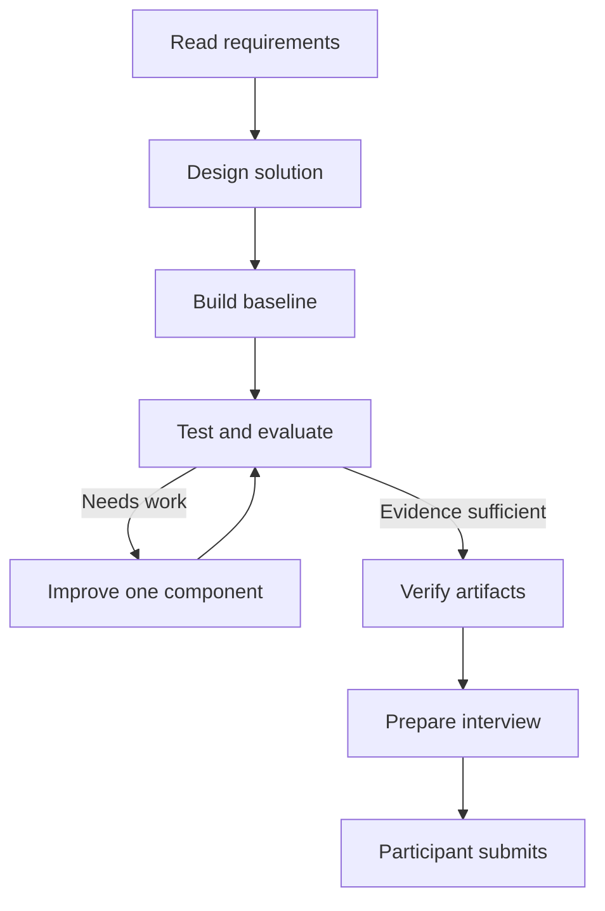
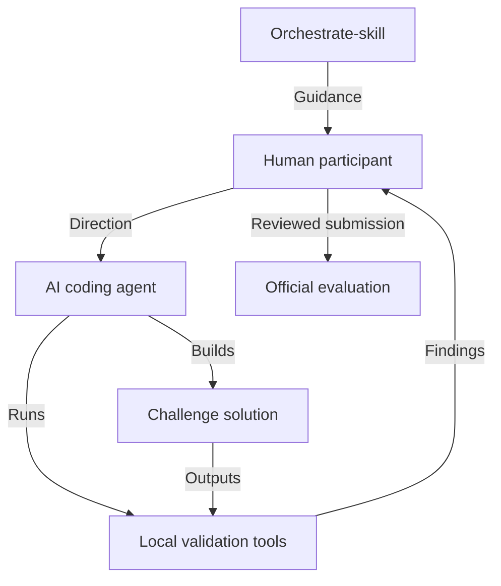

# Orchestrate-skill

### Understand the challenge. Build with evidence. Verify before submitting.

**Created and maintained by [SANTHEESH](https://github.com/santheesh73)** · Version **3.2.0**

[](https://github.com/santheesh73/Orchestrate-skill/actions/workflows/validate.yml)
[](LICENSE)

An independent community toolkit for planning, building, evaluating and packaging
HackerRank Orchestrate solutions with your AI coding assistant.

[Understand Orchestrate](#what-is-hackerrank-orchestrate) ·
[Evaluation](#how-hackerrank-orchestrate-evaluation-works) ·
[Get started](#getting-started) · [Example](#example-using-orchestrate-skill-from-start-to-finish) ·
[Documentation](#documentation)

## What is HackerRank Orchestrate?

HackerRank Orchestrate is a hackathon focused on building AI agents. The
[October 2026 event page](https://www.hackerrank.com/hackerrank-orchestrate-october26)
advertises a 24-hour format. Participants must turn a problem statement into a
working system and be able to explain their engineering decisions.

There are **two different agents** in this workflow:

- **Your coding assistant** helps you plan, write, debug and review code.
- **Your challenge solution** is the agent or software system you build to process
  the challenge inputs and produce the required results.

The development conversation and the solution's runtime logs serve different
purposes. A long conversation with a coding assistant does not demonstrate that
the resulting system works.

**Source scope:** organizer sources were checked on **2026-10-24**. The current
event page confirms the broad format; it does not establish every edition's
schema, logging rules or scoring weights. Historical details below identify their
edition. Engineering recommendations are advice from this toolkit. Community
observations in the linked field guide are contextual evidence, not official rules.
**Your edition's organizer instructions and starter repository take precedence.**

## What participants build

A starter repository provides the task, data and development instructions. Read
its `README.md`, `problem_statement.md` and agent instructions before making
changes. The task determines the required architecture, tool access and artifacts.

For example, the official [June 2026 starter](https://github.com/interviewstreet/hackerrank-orchestrate-june26)
asks for visual damage-claim verification; the
[September 2026 starter](https://github.com/interviewstreet/hackerrank-orchestrate-september26)
asks for personalized affordability decisions. Both use structured input data and
generated CSV outputs. These are historical examples, not a universal schema.

**Illustrative example, not an official task:** a support agent receives a ticket,
retrieves an approved policy through a search tool, checks whether the evidence
supports a response, and chooses a response or escalation. It then emits a row
with an ID, decision and evidence reference. Code checks the required fields and
allowed values before writing the output. Missing evidence must have an explicit
handling path rather than a fabricated explanation.

Architecture determines how evidence reaches a decision; tests establish whether
that decision and its output are valid. A fluent model response alone proves neither.

## How to approach an Orchestrate challenge

The following stages are **engineering recommendations**, not a fixed competition
timetable. Allocate time according to your edition's deadline and the risks you find.

### Stage 1 — Understand the problem

Extract the inputs, outputs, required files, constraints, allowed values,
evaluation criteria, prohibited behavior and submission requirements into a
written contract. Resolve ambiguous instructions before coding; an implementation
of the wrong schema can fail even when its decision logic is sound.

### Stage 2 — Design the solution

Choose an architecture suited to the task. Define tools, prompts and structured
model observations; decide what needs model interpretation and what code must
validate or calculate. Specify uncertainty handling, retries, stopping conditions
and failure recovery. Treat dataset text and retrieved content as untrusted input.

### Stage 3 — Build a baseline

Build the simplest complete input-to-output pipeline. Run the whole sample,
inspect actual rows and verify that the required artifact is produced before
optimizing individual components.

### Stage 4 — Test and evaluate

Test normal, boundary, malformed and adversarial inputs. Check the output schema,
repeatability and recovery from unavailable tools or invalid model responses.
Keep task correctness checks separate from formatting checks.

### Stage 5 — Improve systematically

Save a baseline, change one meaningful component and rerun comparable checks.
Measure regressions across the whole output, record accepted and rejected
experiments, and avoid tuning rules to individual sample IDs. A sample improvement
is evidence to investigate, not proof of generalization.

### Stage 6 — Prepare the submission

Verify required artifacts, output coverage and dependency reproducibility. Check
transcript logging and usage reporting where your edition requires them. Rehearse
the architecture, measured tradeoffs and limitations against the code you will submit.



## How HackerRank Orchestrate evaluation works

**Historical organizer evidence:** the
[June 8, 2026 organizer retrospective](https://www.hackerrank.com/blog/behind-the-scenes-of-hackerrank-orchestrate/)
describes the **first edition, held May 1, 2026**, using four signals:

| Artifact or assessment | Historical weight | What it demonstrates |
|---|---:|---|
| Code ZIP | 30% | The implementation actually shipped |
| Generated output CSV | 30% | Task behavior on the evaluated inputs |
| AI-assisted development transcript | 10% | How the participant directed the coding assistant |
| Technical AI judge interview | 30% | Understanding and ownership of the solution |

**These weights describe that edition, not guaranteed current scoring.** The
organizer explicitly says future editions may change them. Follow your current rubric.

### Code evaluation

The historical rubric examines architecture, prompt/tool design, robustness and
engineering quality through the shipped implementation.

### Output evaluation

Historical judging assesses correctness, safety and decision justifications.
Recommended local checks also cover formatting, row coverage, evidence and generalization.

### Transcript evaluation

The historical assessment examines problem-solving, developer decisions,
iteration, testing and responsible AI use in the development conversation.

### Interview evaluation

The historical interview probes implementation knowledge, judgment, communication
and honest limits. Prepare code-grounded explanations of your tradeoffs and ownership.

### Official evaluation versus local evaluation

**Official evaluation** is performed by the organizers using their rubric and
private assessment process. **Local evaluation** is performed by you and your
tools on the evidence available to you. This toolkit can check configured
contracts, compare outputs and identify specific problems. It cannot predict
hidden official scores with certainty or certify organizer acceptance.

## Common challenges

### What commonly reduces evaluation quality?

Use these as engineering review prompts, not a claimed frequency ranking or
universal list of official penalties:

| Risk | Practical consequence |
|---|---|
| Invalid output schema or missing rows | The artifact may violate the task contract |
| Weak architecture or generic justifications | Decisions are difficult to inspect or defend |
| Untested assumptions and dataset overfitting | A solution can fail beyond the visible examples |
| Inconsistent logs or unsupported claims | Submitted evidence does not match the work |
| Poor interview preparation | The participant cannot explain the shipped implementation |

## Introducing Orchestrate-skill

Orchestrate-skill is a structured engineering companion for AI-assisted
Orchestrate development. It helps you interpret requirements, plan architecture,
write useful coding-agent prompts, review progress, validate outputs, track
experiments, identify errors, prepare artifacts and rehearse technical interviews.

The core skill normally supplies strategy and prompts for your coding agent.
Companion skills add focused design, packaging and practice guidance. Executable
Python tools perform checks **when you or your coding agent run them**. Reading a
skill does not automatically execute its scripts, build a solution or submit an entry.

The toolkit's principle is **model describes, code decides**: use typed model
observations where appropriate and enforce explicit constraints in code. This is
a design recommendation; choose and evaluate the agent behavior your task requires.

## How Orchestrate-skill improves your workflow

| Challenge | Without a structured workflow | How Orchestrate-skill helps |
|---|---|---|
| Changing requirements | Assumptions carry over from another edition | Starter-contract guidance and requirement extraction |
| Choosing architecture | Tools are selected before the problem is understood | Design companion and task archetypes |
| Managing coding-agent prompts | Requests lack constraints or review criteria | Kickoff, iteration and freeze templates |
| Detecting output mistakes | Manual spot checks miss structural errors | Schema, coverage, enum and full-output checks |
| Avoiding overfitting | Sample-specific rules appear to improve results | Generalization guidance and limited literal-data audits |
| Tracking experiments | Changes lack a comparable baseline | Baseline/final snapshots, diffs and change records |
| Preparing for interviews | Answers remain generic | Source-derived questions and guided practice |
| Final submission verification | Missing files surface during upload | Explicit contract, allowlist and package manifest |

### Where the skill adds value

**Before coding:** extract requirements and plan. **During development:** direct
and review focused iterations. **During evaluation:** validate outputs and examine
regressions. **Before submission:** check artifacts and rehearse explanations.
These are workflow benefits, not guaranteed score improvements.



## What's inside Orchestrate-skill?

“Guidance” requires participant or coding-agent action. “Implemented” means an
executable component exists; it does not imply universal coverage or live-agent verification.

| Component | Capability and status | Details |
|---|---|---|
| Main `SKILL.md` | Implemented guidance: planning, prompts, review and next-step routing | [Core skill](hackerrank-orchestrate/SKILL.md) |
| References and templates | Guidance: architecture, evaluation, prompts, decisions and experiment records | [References](hackerrank-orchestrate/references/) · [Assets](hackerrank-orchestrate/assets/) |
| Ten original checkers | Implemented: contract extraction, logs, CSV preflight, rerun diffs, experiments, usage, interview questions, corpus literals and claims | [Scripts](hackerrank-orchestrate/scripts/) · [Coverage](docs/COVERAGE.md) |
| Offline CLI | Implemented: owned installs, configured evaluation, audit controls and evidence-gated workflow checkpoints | [CLI reference](docs/CLI.md) |
| Design companion | Guidance for architecture and a written design | [Design skill](skills/hackerrank-orchestrate-design/SKILL.md) |
| Packaging companion | Guidance + contract-driven submission builder | [Package skill](skills/hackerrank-orchestrate-package/SKILL.md) |
| Practice companion | Guidance for source-grounded interview rehearsal | [Practice skill](skills/hackerrank-orchestrate-practice/SKILL.md) |
| Evidence companion | Implemented behavior grading, paired comparisons, requirement links and interview citation checks; semantic/live review remains separate | [Evidence skill](skills/hackerrank-orchestrate-evidence/SKILL.md) |
| Optional integration companion | Guidance for separately installed community tools; no upstream implementation bundled | [Integration skill](skills/hackerrank-orchestrate-toolkit/SKILL.md) |
| Fixtures and tests | Synthetic evaluation examples, regression and hostile-input tests | [Offline example](examples/offline/) · [Tests](tests/) |
| Skill distribution tools | Implemented: validate and package the skills themselves | [Developer tools](tools/) · [Installation](docs/INSTALL.md) |

Roadmap items are proposals, not implemented feature claims. Workflow `SUBMIT`
records a local approved handoff; it does not upload files.

## Getting started

### Prerequisites and installation

Use Git and **Python 3.9+**. The checkout-based runtime uses the standard library
and needs no API key. Run these commands in PowerShell or a POSIX shell where
`python` selects Python 3; substitute `py -3` on Windows or `python3` if necessary.

```text
git clone https://github.com/santheesh73/Orchestrate-skill.git
cd Orchestrate-skill
python -m orchestrate_toolkit validate
python -m orchestrate_toolkit audit-selftest
```

From the toolkit root, install into an **existing challenge checkout**. Replace
`../my-entry` with your project path. The first command previews the changes.

```text
python -m orchestrate_toolkit install --agent codex --project ../my-entry --dry-run
python -m orchestrate_toolkit install --agent codex --project ../my-entry
python -m orchestrate_toolkit doctor --project ../my-entry
```

Optional: `python -m pip install .` provides the `orchestrate-toolkit` console
command; build dependencies may need downloading. Manual installation, supported
user-scope installs and removal are documented in [INSTALL.md](docs/INSTALL.md).
The owned installer refuses unowned or edited files; owned upgrades require
`--upgrade` and create backups. It does not replace root agent instructions.

### Coding-agent compatibility

Statuses describe the evidence available in this repository, not a promise about
all product versions. Filesystem lifecycle tests do not prove live activation.

| Agent or route | Installation | Evidence status |
|---|---|---|
| Claude Code, original core | Historical native-skill smoke test | **VERIFIED**, 2026-10-13 only; current universal adapter remains unverified |
| Codex, Claude Code, Gemini CLI, OpenCode | `--agent codex`, `claude`, `gemini`, `opencode`; native folders | **DOCUMENTED BUT UNVERIFIED** for current live adapters |
| Cursor, Copilot, Windsurf, Cline, Roo Code, Continue | `--agent cursor`, `copilot`, `windsurf`, `cline`, `roo`, `continue`; rule/instruction adapters | **DOCUMENTED BUT UNVERIFIED**; surface-dependent |
| Aider; other instruction-capable agents | `--agent aider` or `--agent portable`; explicitly load guidance | **MANUAL** |
| Google Antigravity | Legacy manual instructions; no CLI agent ID | **MANUAL**, not live-verified |
| Unknown CLI agent IDs or guessed global rule paths | No supported installation route | **UNSUPPORTED** |

See the [full compatibility matrix](docs/COMPATIBILITY.md) for paths, evidence and
invocation procedures. Do not assume automatic activation. Confirm the actual
skill file read in the coding assistant's tool evidence; Aider needs explicit loading.

### First invocation

Open your coding assistant in the challenge checkout and send:

```text
Use hackerrank-orchestrate. The Orchestrate starter repository is available.
Read its instructions, extract the requirements, identify evaluation risks,
and help me plan a reliable implementation before writing code.
Identify the installed skill file you read and flag missing evidence.
```

A useful response should identify the governing files, required artifacts and
output schema; propose an architecture and baseline; list evaluation risks,
unresolved questions and the next verifiable action. It should distinguish
confirmed requirements from assumptions.

## Example: Using Orchestrate-skill from start to finish

**Fictional challenge:** route requests to `ok` or `review`. This walkthrough uses
the bundled two-row offline fixture. It is not a real entry or an official benchmark.

| Step | Participant and coding-agent work | Skill contribution |
|---|---|---|
| 1. Receive starter | Inspect instructions, data and templates | Points to the contract check |
| 2. Read requirements | Write down IDs, allowed statuses and required files | Extraction helper and contract guidance |
| 3. Select architecture | Define parsing, decisions and validation boundaries | Design companion |
| 4. Build baseline | Implement the complete producer | Focused kickoff prompt and baseline discipline |
| 5. Run tests | Exercise normal and malformed requests | Test-plan guidance and local checkers |
| 6. Detect failure | Suppose an empty request causes a missing row | Coverage checking exposes the gap when configured |
| 7. Improve | Apply the fictional task's fallback rule; rerun all cases | Change record and regression review |
| 8. Validate outputs | Inspect exact schema, IDs and replay results | Configured evaluation report |
| 9. Prepare artifacts | Review the real contract, package and rehearse | Packaging and practice companions |

The missing-row failure and repair above are illustrative, not a claimed measured
experiment. Run the working offline example from the toolkit root:

```text
python examples/offline/main.py
python -m orchestrate_toolkit evaluate --project examples/offline --config evaluation.json --report evaluation/readme-demo-001.json
```

The bundled configuration checks its contract and keyed replay. A PASS does not
establish semantic correctness. Inspect the report and use a new report filename
each time; reports are not overwritten.

For your **prepared challenge project**, first create its contract using the
[contract format](skills/hackerrank-orchestrate-package/references/contract.md).
The following command checks the files without building a bundle:

```text
python skills/hackerrank-orchestrate-package/scripts/package_submission.py --repo ../my-entry --contract ../my-entry/submission-contract.json --out submission-final --check-only
```

After reviewing findings, omit `--check-only` to build into a new output directory.
Inspect the manifest and archive before uploading through the organizer's process.
`PACKAGE BUILT` is a local result, not an official readiness verdict. Include the
edition's required logs, usage records and evaluation evidence; rehearse the actual
implementation rather than invented scores.

## Validation and testing

For a quick repository check:

```text
python tools/validate_skill.py
python tools/static_check.py
python -W error -m unittest discover -s tests -v
```

The suite contains **262 tests**, including CLI hostile-input cases, install
ownership, packaging, contract/replay checks and stale-evidence workflow gates.
CI targets Windows, Linux and macOS on Python 3.9, 3.11 and 3.13. These checks
validate toolkit behavior; they do not validate your challenge solution by default.

The public audit selftest exercises **7 healthy, 10 injected-defect and 4
metamorphic controls**. Its passing report cannot substitute for participant
submission evaluation. See [release evidence](docs/V2_RELEASE_EVIDENCE.md) for
version-specific records; the badge reflects CI on main, not local README edits.

Local reports distinguish **PASS**, **WARN**, **FAIL** and **UNKNOWN**. Missing or
unsupported evidence must remain visible. Exit codes differ by tool; consult the
[CLI reference](docs/CLI.md) or each script's `--help`. Formatting and literal-ID
checks cannot prove decision accuracy, safety or generalization.

For hackathon practice and skill effectiveness work, the new evidence companion
adds **eight fictional cases** and **24 healthy/injected behavior-grader controls**:

```text
python tools/evaluate_behavior.py selftest --suite evals/behavior
```

These are offline grader checks, not live coding-agent trials. Follow the
[behavior evaluation guide](docs/BEHAVIOR_EVALUATION.md) for paired experiments,
the [complete practice exercise](docs/HACKATHON_PRACTICE.md) for failure-to-package
rehearsal, and the [live verification procedure](docs/LIVE_VERIFICATION.md) before
claiming an integration works. Requirement and interview checks bind citations to
current file hashes; they leave semantic satisfaction UNKNOWN pending review.
See the [3.2 verification record and limits](docs/HACKATHON_EVIDENCE_RELEASE.md),
including the locally blocked Windows console-launcher check.

## Repository structure

```text
Orchestrate-skill/
├── hackerrank-orchestrate/   Main skill, references, checker scripts and assets
├── skills/                  Five companion skills
├── orchestrate_toolkit/     Offline CLI and implementation
├── integrations/            Agent integration resources
├── examples/                Offline example and complete hackathon practice
├── tests/                   Regression tests and fixtures
├── evals/                   Trigger and behavioral evaluation cases
├── tools/                   Skill validation, distribution and smoke tools
├── docs/                    Installation, architecture and technical guides
├── LICENSE
└── THIRD_PARTY_NOTICES.md
```

## Documentation

- [Installation and recovery](docs/INSTALL.md) · [Compatibility evidence](docs/COMPATIBILITY.md)
- [CLI commands and configuration](docs/CLI.md) · [Architecture and trust boundaries](docs/ARCHITECTURE.md)
- [Evaluation policy](hackerrank-orchestrate/references/evaluation.md) · [Capability coverage](docs/COVERAGE.md)
- [Prompt templates](hackerrank-orchestrate/references/prompt-templates.md) · [Task archetypes](hackerrank-orchestrate/references/archetypes/index.md)
- [Interview guidance](hackerrank-orchestrate/references/interview.md) · [Optional integration](docs/integrations/community-toolkit.md)
- [Historical strategy, rubric and credited sources](docs/HACKATHON_GUIDE.md)
- [Behavior evaluation](docs/BEHAVIOR_EVALUATION.md) · [Live verification](docs/LIVE_VERIFICATION.md) · [Hackathon practice](docs/HACKATHON_PRACTICE.md)
- [Changelog](CHANGELOG.md) · [Security policy](SECURITY.md)

## Limitations

- Current official rules supersede historical profiles and community guidance.
- No local check, heuristic score or synthetic fixture guarantees hidden-grader
  performance, interview results, organizer acceptance or a prize.
- Current universal adapters lack live invocation verification. Offline trigger
  proxies are not evidence of live model behavior.
- Literal-data audits have limited scope and are not dataflow analysis or proof
  against overfitting. Configuration accuracy remains the participant's responsibility.
- Optional external tools and live model evaluations need separate setup and may
  require credentials. No paid model evaluation runs implicitly.
- Opt-in command execution uses host permissions; this toolkit is not an OS sandbox.
  It does not submit, upload or deploy for you.

## Contributing

Read [CONTRIBUTING.md](CONTRIBUTING.md) before proposing changes. Include evidence
for new capabilities, preserve existing skills and label historical observations
and unverified integrations. Use synthetic fixtures without secrets. Run the
validation commands above and explain what changed, how it was checked and its limits.

## Creator and acknowledgments

**Created and maintained by SANTHEESH** — [GitHub profile](https://github.com/santheesh73).

Orchestrate-skill is independently maintained. Third-party authors retain credit
for their material and methods; applicable source revisions, acknowledgments and
license notices are preserved in [THIRD_PARTY_NOTICES.md](THIRD_PARTY_NOTICES.md).
Organizer documentation and historical sources are credited where used and in the
field guide. This project's authorship does not imply authorship of those sources.

## License and unofficial disclaimer

[MIT License](LICENSE), copyright © 2026 santheesh73. Preserve the license and
applicable third-party notices when redistributing or adapting the project.

**Orchestrate-skill is an independent, unofficial community project. It is not affiliated with, sponsored by, or endorsed by HackerRank.**

HackerRank and related trademarks belong to their respective owners.
