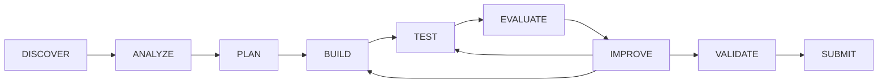

# Architecture

The canonical sources stay in `hackerrank-orchestrate/` and `skills/`. Existing
checkers keep their interfaces. The new standard-library `orchestrate_toolkit`
package composes those capabilities and generates disposable installation copies.
`integrations/skill-catalog.json` maps the ten requested capabilities to source
guidance. It does not duplicate the instructions.

## Layers

1. Skills: task scope, progressive references, explicit inputs/outputs/recovery.
2. Adapters: a documented registry and small generated pointers or native skill
   copies. Generated outputs are never the maintained source of truth.
3. Installer: confined paths, preflight conflicts, shared ownership and hashes,
   per-project operation lock, rollback and explicit backed-up owned upgrades.
4. Workflow: local state and append-style structured history in an atomic JSON
   checkpoint. Normal transitions are sequential; IMPROVE can return to BUILD or
   TEST. Explicit bounded recovery returns to an earlier/current state.
5. Evaluation: strict contract checks, row comparisons, optional local fixture
   execution, supplied usage/prices, dependency presence and source bindings.
6. CLI: explicit commands; no agent is launched, no network or paid API is needed.

Optional contract audits use a closed built-in registry in `audits.py`. The first
policy, `decision_ids`, reads IDs from the validated input and parses declared
Python source without importing it. Unsupported source yields UNKNOWN. The
broader original corpus heuristic remains unchanged and serves a different
investigation purpose. No third-party plugins load from project configuration.

`audit-selftest` exercises contract, decision-ID and replay audits with healthy,
mutated and metamorphic fixtures. Its report kind is `audit_selftest`, so it cannot
satisfy workflow gates requiring participant `evaluation` evidence. The separate
comparison runner produces diagnostic reports, not readiness verdicts.

## State and trust

Arrows are explicit evidence-gated CLI transitions; SUBMIT is a local approved
handoff, not an upload.

`.orchestrate/install.json` tracks only generated files. Uninstall checks hashes
before deleting owned files, preserves edits, shared files, unowned instructions,
backups and workflow state. Empty directories can remain deliberately. Root
AGENTS.md, CLAUDE.md and GEMINI.md are never adapter outputs.

`.orchestrate/workflow.json` records state, evidence hashes, failures and recovery
counts. TEST, EVALUATE and VALIDATE need a PASS evaluation report whose source
hashes still match. SUBMIT requires explicit approval and a checked package
manifest; it records a handoff and never uploads. A gate failure leaves the state
unchanged. Three failures require explicit recovery, bounded to three recoveries.

Evidence files are local claims, not cryptographic attestations. A user who edits
their own ledger/reports can manufacture evidence; this system does not replace
competition authorship or human review. Damaged or foreign state is refused.

## Execution boundary

Evaluation config is data, never automatic authorization. `--allow-exec` explicitly
permits its local argument-array checks; no shell strings are accepted. Retries
apply only to timeouts and are bounded; opt into them only for repeatable checks.
The runner suppresses child output and does not forward environment credentials
unless each variable is explicitly requested with `--pass-env`.

Executed Python or another allowed program still has host filesystem/network
permissions. There is no OS sandbox. Use a user-provided isolated container or
VM for unfamiliar code; the toolkit does not silently configure one. Commands
such as push, deployment, package installation and remote shells are outside
the check runner and require separate explicit user authorization.

## Distribution

The source-tree command needs no installation. Built wheels contain generated
copies of the canonical skill folders and validation tools. A wheel smoke test
imports and exercises those resources from a temporary installed location rather
than the source checkout. No hardcoded model or API price is configured.

Compatibility has separate documentation, generation/lifecycle simulation and
live inference dimensions. See COMPATIBILITY.md; a native-looking file is not
evidence that a live agent loaded it.
